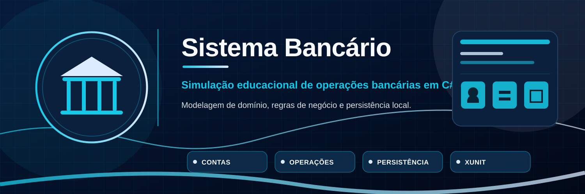
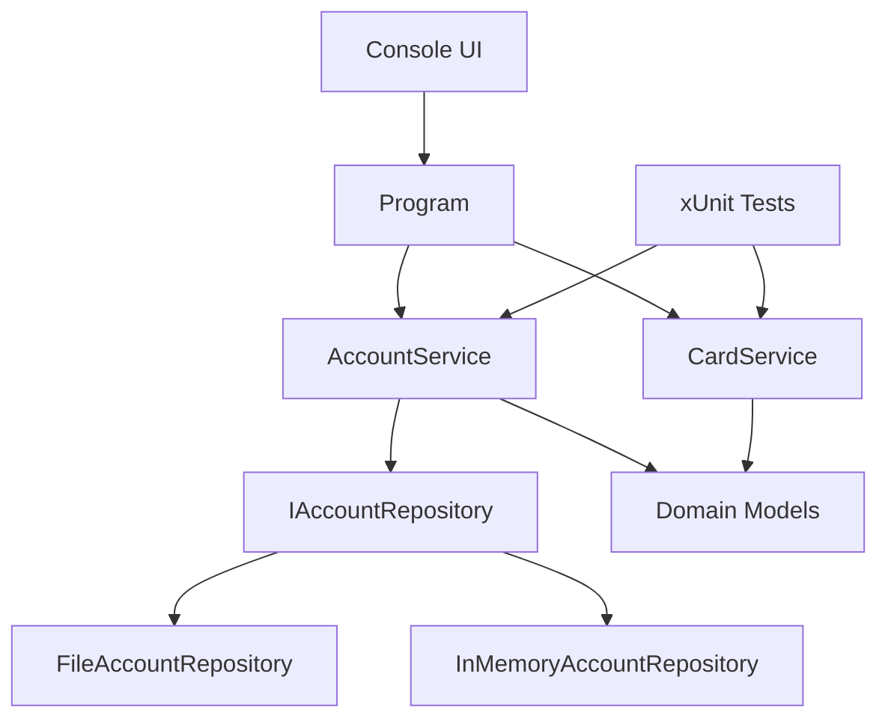

<p align="right"><strong>Language:</strong> <a href="README.md">Português (Brasil)</a> · <a href="README.en.md">English</a></p>

<p align="center"></p>
<p align="center"></p>
<h1 align="center">Banking System</h1>
<p align="center"><strong>Educational console simulation of banking operations in C#.</strong></p>
<p align="center">
  
  
  <a href="https://github.com/RMBarros-Dev/Sistema-Bancario/actions/workflows/dotnet.yml"></a>
  <a href="https://github.com/RMBarros-Dev/Sistema-Bancario/actions/workflows/codeql.yml"></a>
</p>

## Contents

- [01 · Context and project positioning](#01--context-and-project-positioning)
- [02 · Live demonstration and visual references](#02--live-demonstration-and-visual-references)
- [03 · Features and implementation status](#03--features-and-implementation-status)
- [04 · System architecture](#04--system-architecture)
- [05 · Technology stack](#05--technology-stack)
- [06 · Directory structure](#06--directory-structure)
- [07 · Prerequisites and installation](#07--prerequisites-and-installation)
- [08 · Environment and data configuration](#08--environment-and-data-configuration)
- [09 · User guide](#09--user-guide)
- [10 · Testing and quality](#10--testing-and-quality)
- [11 · Internationalization and localization](#11--internationalization-and-localization)
- [12 · Deployment and infrastructure](#12--deployment-and-infrastructure)
- [13 · Security and limitations](#13--security-and-limitations)
- [14 · Additional documentation](#14--additional-documentation)
- [15 · Contribution, license and credits](#15--contribution-license-and-credits)

## 01 · Context and project positioning


### Overview

A .NET console application organized into domain models, services, repository interfaces and a user-interaction layer. The repository also contains an xUnit automated test project.

### Educational Scope

The project simulates selected banking-domain concepts to practice C#/.NET, object-oriented design, business rules, persistence abstractions and automated tests. It is not a real banking product or financial service.

## 02 · Live demonstration and visual references

This repository does not provide a hosted web demo URL or runtime screenshots. The demonstration is local and terminal-based, using the command in the user guide. The banner and logo are brand assets, not evidence of the running interface.

## 03 · Features and implementation status

The status presented here reflects the scope described in the README and the material referenced by the repository. It is not, by itself, operational sign-off or independent validation.

### Functional Areas

Documented capabilities include:
- Credit and debit operations.
- Transfers between accounts.
- Checking and savings account models.
- Demonstrative card-related flows.
- Transaction history and local file persistence.
- An alternative in-memory repository.
- Resource files for localization, including Brazilian Portuguese.
- Automated account and card tests.

## 04 · System architecture


### Domain Model

The application represents account, card and user concepts. Business operations are coordinated by services, while repository abstractions isolate persistence choices. The model is educational and should not be interpreted as a complete financial-domain specification.

### Architecture



## 05 · Technology stack


### Technology Stack

| Area | Technology |
|---|---|
| Language | C# |
| Runtime | .NET 10 |
| Tests | xUnit |
| Domain | Accounts, cards and users |
| Organization | Models, Services, UI and repository interfaces |
| Demonstrative persistence | File-based and in-memory repositories |
| Localization | `.resx` resource files |

## 06 · Directory structure


### Repository Structure

```text
Sistema-Bancario/
├── .github/workflows/dotnet.yml
├── Sistema Bancario/
│   ├── Models/
│   ├── Resources/
│   ├── Services/
│   ├── UI/
│   ├── EnvConfig.cs
│   └── Program.cs
├── SistemaBancario.Tests/
├── assets/brand/
├── appsettings.json
├── build-release.ps1
└── Sistema Bancario.slnx
```

## 07 · Prerequisites and installation


### Requirements

- .NET 10 SDK.
- Terminal or IDE compatible with .NET applications.
- Git for cloning the repository.

### Restore and Run

From the repository root:

```bash
dotnet restore "Sistema Bancario.slnx"
dotnet run --project "Sistema Bancario/Sistema Bancario.csproj"
```

## 08 · Environment and data configuration

This section consolidates the documented configuration and storage information. Sensitive values must be supplied by the runtime environment, never committed.

### Monetary Precision

The domain uses C# `decimal` for monetary values rather than binary floating-point types. Financial-like calculations should preserve explicit rounding and validation rules. This design choice supports the educational simulation but does not make the application suitable for real financial transactions.

### Persistence

The repository includes a file-based account repository and an in-memory alternative. File persistence uses atomic replacement to reduce the risk of partially written JSON. Invalid JSON files produce explicit errors rather than being silently ignored.

The storage implementation is local and educational; it is not a managed, encrypted or highly available financial data store.

## 09 · User guide

Refer to the commands and behavior documented in this README. No additional capabilities are assumed beyond the repository's description.

## 10 · Testing and quality


### Run Automated Tests

```bash
dotnet test "SistemaBancario.Tests/SistemaBancario.Tests.csproj"
```

Tests are kept separately from the main application under `SistemaBancario.Tests/`.

### Quality and Testing

xUnit tests cover selected account and card behavior. Run the test command before relying on changes. Test coverage and CI results should be assessed from the current repository workflows; they do not prove the absence of defects.

## 11 · Internationalization and localization


### Localization Resources

The project includes `.resx` resource files for text localization, including Brazilian Portuguese. Resource presence does not by itself prove complete translation coverage or runtime language-selection behavior in every interface.

## 12 · Deployment and infrastructure

Web-service deployment does not apply to the console application described here. No hosted environment or publishing process is documented.

## 13 · Security and limitations


### Security and Safe Use

This is an educational project. Operations and flows are simulations. Do not use real banking data, real credentials or this software to move money. A real financial system would require, among other controls, security engineering, auditability, encryption, regulatory compliance, additional testing and independent review.

## 14 · Additional documentation


### Documentation and Engineering Principles

- [Project structure](docs/project-structure.md).
- [Brand guide](docs/brand/README.md).
- [.NET workflow](.github/workflows/dotnet.yml).

Relevant principles include separation of responsibilities, persistence abstraction, tests for domain rules, environment-based configuration and data protection.

## 15 · Contribution, license and credits

When proposing changes, describe the goal, affected files and validation performed. Prefer small, reviewable changes; include tests when behavior changes and never submit credentials, tokens or personal data.

### Development Methodology

Models represent domain concepts, services coordinate operations, repository interfaces decouple persistence and tests verify selected behaviors. Changes to simulated financial rules should include corresponding tests.

### License and Attribution

See [LICENSE.txt](LICENSE.txt) for the repository license and applicable terms.
