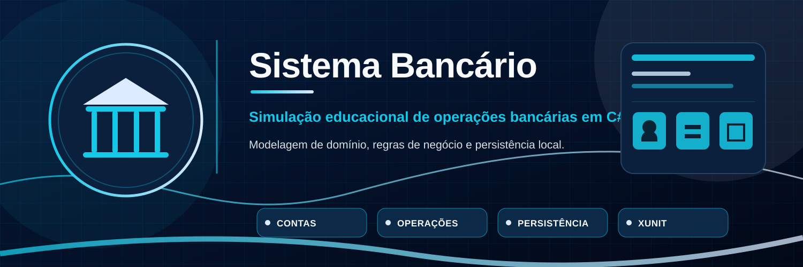
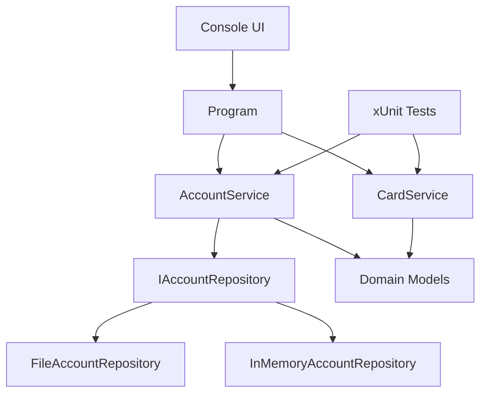
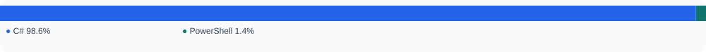

<p align="right"><strong>Language:</strong> <a href="README.pt-BR.md">Português (Brasil)</a> · <a href="README.md">English</a></p>

<p align="center"></p>
<p align="center"></p>
<h1 align="center">Banking System</h1>
<p align="center"><strong>Precision in rules. Clarity in operations.</strong></p>
<p align="center">Educational console simulation of banking operations in C#.</p>
<p align="center">
  
  
  <a href="https://github.com/RMBarros-Dev/Sistema-Bancario/actions/workflows/dotnet.yml"></a>
  <a href="https://github.com/RMBarros-Dev/Sistema-Bancario/actions/workflows/codeql.yml"></a>
</p>

## Contents

- [01 · Overview](#01--overview)
- [02 · Educational Scope](#02--educational-scope)
- [03 · Functional Areas](#03--functional-areas)
- [04 · Domain Model](#04--domain-model)
- [05 · Architecture](#05--architecture)
- [06 · Technology Stack](#06--technology-stack)
- [07 · Requirements](#07--requirements)
- [08 · Restore and Run](#08--restore-and-run)
- [09 · Run Automated Tests](#09--run-automated-tests)
- [10 · Monetary Precision](#10--monetary-precision)
- [11 · Persistence](#11--persistence)
- [12 · Localization Resources](#12--localization-resources)
- [13 · Security and Safe Use](#13--security-and-safe-use)
- [14 · Quality and Testing](#14--quality-and-testing)
- [15 · Repository Structure](#15--repository-structure)
- [16 · Development Methodology](#16--development-methodology)
- [17 · Documentation and Engineering Principles](#17--documentation-and-engineering-principles)
- [18 · License and Attribution](#18--license-and-attribution)

## 01 · Overview

A .NET console application organized into domain models, services, repository interfaces and a user-interaction layer. The repository also contains an xUnit automated test project.

## 02 · Educational Scope

The project simulates selected banking-domain concepts to practice C#/.NET, object-oriented design, business rules, persistence abstractions and automated tests. It is not a real banking product or financial service.

## 03 · Functional Areas

Documented capabilities include:
- Credit and debit operations.
- Transfers between accounts.
- Checking and savings account models.
- Demonstrative card-related flows.
- Transaction history and local file persistence.
- An alternative in-memory repository.
- Resource files for localization, including Brazilian Portuguese.
- Automated account and card tests.

## 04 · Domain Model

The application represents account, card and user concepts. Business operations are coordinated by services, while repository abstractions isolate persistence choices. The model is educational and should not be interpreted as a complete financial-domain specification.

## 05 · Architecture



## 06 · Technology Stack

| Area | Technology |
|---|---|
| Language | C# |
| Runtime | .NET 10 |
| Tests | xUnit |
| Domain | Accounts, cards and users |
| Organization | Models, Services, UI and repository interfaces |
| Demonstrative persistence | File-based and in-memory repositories |
| Localization | `.resx` resource files |

## 07 · Requirements

- .NET 10 SDK.
- Terminal or IDE compatible with .NET applications.
- Git for cloning the repository.

## 08 · Restore and Run

From the repository root:

```bash
dotnet restore "Sistema Bancario.slnx"
dotnet run --project "Sistema Bancario/Sistema Bancario.csproj"
```

## 09 · Run Automated Tests

```bash
dotnet test "SistemaBancario.Tests/SistemaBancario.Tests.csproj"
```

Tests are kept separately from the main application under `SistemaBancario.Tests/`.

## 10 · Monetary Precision

The domain uses C# `decimal` for monetary values rather than binary floating-point types. Financial-like calculations should preserve explicit rounding and validation rules. This design choice supports the educational simulation but does not make the application suitable for real financial transactions.

## 11 · Persistence

The repository includes a file-based account repository and an in-memory alternative. File persistence uses atomic replacement to reduce the risk of partially written JSON. Invalid JSON files produce explicit errors rather than being silently ignored.

The storage implementation is local and educational; it is not a managed, encrypted or highly available financial data store.

## 12 · Localization Resources

The project includes `.resx` resource files for text localization, including Brazilian Portuguese. Resource presence does not by itself prove complete translation coverage or runtime language-selection behavior in every interface.

## 13 · Security and Safe Use

This is an educational project. Operations and flows are simulations. Do not use real banking data, real credentials or this software to move money. A real financial system would require, among other controls, security engineering, auditability, encryption, regulatory compliance, additional testing and independent review.

## 14 · Quality and Testing

xUnit tests cover selected account and card behavior. Run the test command before relying on changes. Test coverage and CI results should be assessed from the current repository workflows; they do not prove the absence of defects.

## 15 · Repository Structure

```text
Sistema-Bancario/
├── .github/workflows/dotnet.yml
├── Sistema Bancario/
│   ├── Models/
│   ├── Resources/
│   ├── Services/
│   ├── UI/
│   ├── EnvConfig.cs
│   └── Program.cs
├── SistemaBancario.Tests/
├── assets/brand/
├── appsettings.json
├── build-release.ps1
└── Sistema Bancario.slnx
```

## 16 · Development Methodology

Models represent domain concepts, services coordinate operations, repository interfaces decouple persistence and tests verify selected behaviors. Changes to simulated financial rules should include corresponding tests.

## 17 · Documentation and Engineering Principles

- [Project structure](docs/project-structure.md).
- [Brand guide](docs/brand/README.md).
- [.NET workflow](.github/workflows/dotnet.yml).

Relevant principles include separation of responsibilities, persistence abstraction, tests for domain rules, environment-based configuration and data protection.

## 18 · License and Attribution

See [LICENSE.txt](LICENSE.txt) for the repository license and applicable terms.


## Engineering Metrics

<div align="center">
  
  
  
  
</div>

<!-- REPOSITORY_METRICS_START -->
### Language distribution (GitHub Linguist)



| Language | Source bytes | Share |
|---|---:|---:|
| C# | 28,507 | 98.56% |
| PowerShell | 416 | 1.44% |

_Total measured source bytes: 28,923. Refreshed: 2026-11-26 13:55 UTC._

<!-- REPOSITORY_METRICS_END -->

### Technical verification

| Dimension | Implemented evidence | Measurement boundary |
|---|---|---|
| Runtime / language | C# on .NET 10 | Educational console application. |
| Architecture | Models, services, UI and repository abstractions | File-based and in-memory repository implementations are documented. |
| Persistence | Local JSON file storage and in-memory alternative | Not an encrypted, managed or highly available data store. |
| Localization | .resx resource files, including Brazilian Portuguese | Resource presence does not prove full translation coverage. |
| Automated tests | Separate xUnit test project | Run with dotnet test; no coverage percentage published. |
| CI | [dotnet workflow](.github/workflows/dotnet.yml) | Current result is shown by the workflow badge above. |
| Static security analysis | [CodeQL workflow](.github/workflows/codeql.yml) | Workflow execution is not a security certification. |
