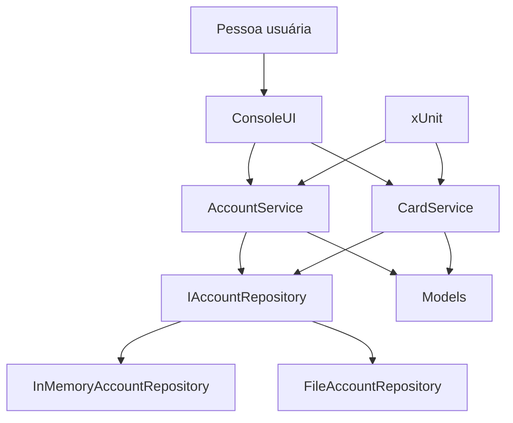

# Arquitetura do Sistema Bancário

## Visão geral

Mantenho este projeto como uma aplicação de console em C# para simular operações bancárias. Organizo responsabilidades em modelos, serviços, repositórios e interface de console.

## Componentes observados

| Componente | Responsabilidade |
|---|---|
| `Models/` | Contas, cartões e usuários |
| `Services/AccountService.cs` | Operações de conta e regras de negócio |
| `Services/CardService.cs` | Operações relacionadas a cartões |
| `IAccountRepository` | Contrato para persistência de contas |
| `InMemoryAccountRepository` | Persistência temporária em memória |
| `FileAccountRepository` | Persistência em arquivo |
| `UI/ConsoleUI.cs` | Interação com a pessoa usuária |
| `SistemaBancario.Tests/` | Testes automatizados com xUnit |

## Fluxo arquitetural

## Qualidade

O workflow na branch `master` restaura e compila o aplicativo e executa o projeto de testes xUnit. Já mantenho testes para depósitos, saques, transferências e operações de cartão.

## Limites de uso

Trato a aplicação exclusivamente como simulação educacional. Não a utilizo para movimentação financeira real, armazenamento de informações bancárias ou processamento de pagamentos.

## Referências

- [README](../../README.md)
- [Contribuição](../../CONTRIBUTING.md)
- [Política de segurança](../../SECURITY.md)
- [Decisão arquitetural atual](../decisions/0001-current-architecture.md)
